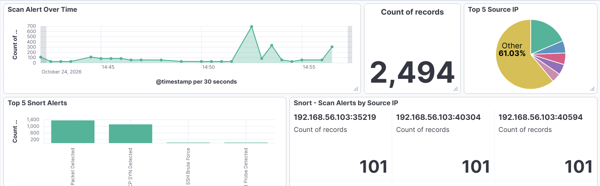

# Port Scan Detection Engineering Lab

## Project Overview
This project demonstrates a network reconnaissance detection lab using Kali Linux, Nmap, Snort, and the ELK Stack (Elasticsearch, Logstash, and Kibana).

The goal is to detect different types of Nmap port scans, visualize security alerts in Kibana, and configure threshold-based SIEM detection while reducing false positives.

## Tools Used
- Kali Linux
- Nmap
- Snort IDS
- Elasticsearch
- Logstash
- Kibana

## Lab Architecture
- Scanner VM: Kali Linux running Nmap
- Target/Monitoring VM: Snort and ELK Stack
- Snort generates alerts from network traffic.
- Alerts are collected and indexed for analysis in Kibana.
- A Kibana log threshold rule identifies repeated alert activity.

## Scan Types Tested
- TCP SYN Scan
- TCP ACK Scan
- TCP FIN Scan
- TCP NULL Scan
- TCP Xmas Scan
- UDP Scan

## Detection and SIEM
Custom Snort rules were used to detect selected TCP and UDP traffic patterns.

Kibana Discover was used to investigate alerts, and a log threshold rule named `Snort Port Scan Reconnaissance` was configured with a threshold of more than 20 log entries in 5 minutes, grouped by source IP-and-port field.

## False Positive Reduction
- Reviewed noisy ACK-only alerts.
- Investigated alerts by signature ID and source field.
- Increased the detection threshold to reduce alerts from low-volume traffic.
- Further tuning and separating source IP from source port remain possible improvements.

## Results
- Generated Snort alerts for multiple scan types.
- Verified alerts in Kibana Discover.
- Configured and tested a threshold-based SIEM alert.
- Identified opportunities to improve source-IP grouping and reduce false positives.

## Future Improvements
- Parse source IP and source port into separate fields.
- Tune thresholds using baseline traffic.
- Add dashboards for scan types and alert severity.
- Document additional false-positive tests.

## Disclaimer
This lab is intended for authorized testing in a controlled virtual environment only.

## Snort Dashboard

The dashboard visualizes Snort alerts over time, common alert types, and source IP activity.

